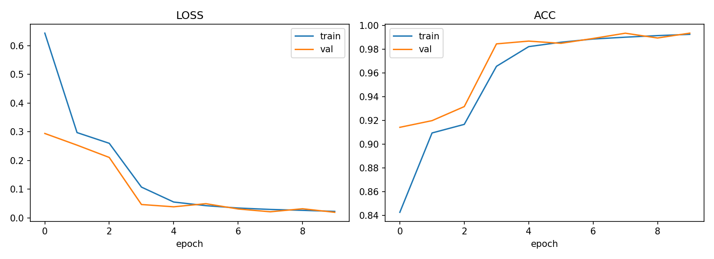

# Plant Disease Classifier — Transfer Learning + Explainable AI

A computer vision project that classifies crop leaf images as healthy or diseased across
**38 classes** using transfer learning, then explains *why* the model made each prediction
using Grad-CAM. Includes a Gradio demo for interactive testing.

> **Experimental research project — not a diagnostic tool.** The model has only been validated on
> PlantVillage-style images (single detached leaves on plain backgrounds). Its accuracy on real field
> photos is unknown. See [Limitations](#limitations-and-ml-validity).

## Live Demo

https://plant-disease-classifier-2-8cm8.onrender.com/

## Why this project

Crop diseases are a major driver of yield loss worldwide, and manual diagnosis by farmers
or agronomists is slow and expertise-dependent. This project builds a lightweight classifier
(ResNet18, ~11M parameters) and pairs it with visual explanations (Grad-CAM heatmaps) so
predictions aren't a black box — important for anything that might influence a real agricultural
decision. A model like this would need validation on field images before it could be used in the field.

It's also a deliberately compact demonstration of a full applied-DL workflow:
transfer learning → two-phase fine-tuning → quantitative evaluation → model
interpretability → a usable demo → automated tests.

## Dataset

[New Plant Diseases Dataset (Augmented)](https://www.kaggle.com/datasets/vipoooool/new-plant-diseases-dataset)
on Kaggle (originally derived from PlantVillage):

- ~87,900 RGB leaf images, 256×256, across **38 classes** (14 crop species × healthy/disease states)
- Pre-split: `train/` (70,295 images), `valid/` (17,572 images), `test/` (33 unlabeled images)
- Directory layout is already `ImageFolder`-compatible (one subfolder per class)
- Per the dataset description, the images were **offline-augmented** before the train/valid split
  (see [Limitations](#limitations-and-ml-validity) for why that matters)

Not included in this repo (too large for git). See [`data/README.md`](data/README.md) for
download instructions.

## Approach

1. **Backbone**: ResNet18 pretrained on ImageNet (swap `--model` for `resnet50` / `efficientnet_b0` / `mobilenet_v2`)
2. **Phase 1 — head training**: freeze the backbone weights, train only the new classification head (fast, stabilizes the new layer)
3. **Phase 2 — fine-tuning**: unfreeze the whole network, train end-to-end at a lower learning rate. Early stopping has a separate patience budget per phase, so a plateau in phase 1 never skips fine-tuning
4. **Augmentation**: random resized crop, horizontal flip, rotation, color jitter. These add robustness to framing and lighting changes; they do **not** remove the dataset's uniform-background bias
5. **Evaluation**: accuracy, macro/weighted precision/recall/F1, per-class report, confusion matrix, `metrics.json`
6. **Explainability**: Grad-CAM heatmaps over the last conv block, to check whether the model attends to lesions/discoloration rather than background
7. **Demo**: Gradio app — upload a leaf photo, get the top-5 classes, model probabilities, and a Grad-CAM overlay aligned with the region the model actually analysed

## Repo structure

```
Plant-Disease-Classifier/
├── README.md
├── requirements.txt          # runtime: inference + Gradio demo (what Render installs)
├── requirements-train.txt    # + training / evaluation extras
├── requirements-dev.txt      # + pytest, ruff
├── freeze.txt                # exact package versions the test suite passed with
├── runtime.txt               # Python version used for deployment (3.11)
├── pyproject.toml            # pytest + ruff configuration
├── data/
│   └── README.md             # dataset download instructions
├── src/
│   ├── dataset.py            # ImageFolder loaders, transforms, crop-box mapping
│   ├── model.py              # model builder, safe checkpoint loading
│   ├── train.py              # two-phase training loop
│   ├── evaluate.py           # metrics, confusion matrix, report
│   ├── gradcam.py            # Grad-CAM implementation
│   └── utils.py              # seeding, device selection, early stopping, helpers
├── app/
│   └── demo.py               # Gradio inference app
├── tests/                    # pytest suite (synthetic data, no dataset download)
├── notebooks/
│   └── colab_train.ipynb     # Colab training notebook (GPU)
├── results/
│   ├── best_model.pt         # trained ResNet18 checkpoint (committed, ~45 MB)
│   ├── class_names.json
│   └── training_curves.png
└── .github/workflows/ci.yml  # lint + tests on every push / PR
```

## Setup

Requires **Python 3.11** (`torch==2.1.2` has no wheels for Python 3.12+).

```bash
git clone https://github.com/TakshChauhan/Plant-Disease-Classifier.git
cd Plant-Disease-Classifier
python3.11 -m venv .venv
source .venv/bin/activate            # Windows: .venv\Scripts\activate

pip install -r requirements.txt        # demo / inference only
pip install -r requirements-train.txt  # also needed to train or evaluate
pip install -r requirements-dev.txt    # also needed to run tests / lint
```

On Linux without a GPU, install the much smaller CPU build of PyTorch first:
`pip install torch==2.1.2 torchvision==0.16.2 --index-url https://download.pytorch.org/whl/cpu`.

Devices are picked automatically: CUDA, then Apple Silicon (MPS), then CPU. Every script accepts
`--device cpu|cuda|mps` to override.

To train or evaluate, download the dataset (see `data/README.md`), so you end up with:
```
data/
├── train/<38 class folders>/
└── valid/<38 class folders>/
```

## Usage

**Run the interactive demo** (uses the committed checkpoint; no dataset or extra downloads needed):
```bash
python app/demo.py                     # http://127.0.0.1:7860
python app/demo.py --device cpu --port 7861
python app/demo.py --share             # temporary public gradio.live link
```

**Train** (two-phase transfer learning). Outputs go to `--output-dir`; the script refuses to overwrite
an existing `best_model.pt` unless you pass `--overwrite`:
```bash
python src/train.py --data-dir data --model resnet18 --freeze-epochs 3 --finetune-epochs 7 \
    --batch-size 32 --output-dir results/run
```
Add `--freeze-bn-stats` to also keep BatchNorm running statistics fixed during phase 1. It is off by
default because the committed checkpoint was trained without it (its BN statistics were updated in
all 10 epochs, which is verifiable from `num_batches_tracked` in the checkpoint).

**Evaluate** a checkpoint on a labelled split:
```bash
python src/evaluate.py --data-dir data --split valid --checkpoint results/best_model.pt \
    --output-dir results/evaluation
```
This writes `classification_report.txt`, `confusion_matrix.png`, and `metrics.json` (including the
checkpoint's SHA-256).

**Run the tests and linter**:
```bash
pytest          # 98 tests, about 10 s on a laptop CPU; no dataset needed
ruff check .
```

## 📊 Results

Reported from the original training run on Google Colab. **These numbers were not re-computed during the
latest code audit** because the dataset is not stored in the repo, and no evaluation report was committed
alongside the checkpoint. Re-run `src/evaluate.py` to reproduce them and get a `metrics.json`.

| Metric | Value |
|---------|-------|
| Validation Accuracy | **99.35%** |
| Macro Precision | **99.3%** |
| Macro Recall | **99.3%** |
| Macro F1 Score | **99.3%** |
| Number of Classes | **38** |
| Validation Images | **17,572** |
| Backbone | **ResNet18 (Transfer Learning)** |
| Hardware | **Google Colab Tesla T4 GPU** |

These are **in-distribution validation** scores. The same `valid/` split was used to choose the best
epoch, and it likely shares near-duplicate (augmented) images with `train/`. They should not be read as
the accuracy you would get on photos taken in a field.

## 📈 Training Curves

<p align="center">
  
</p>

Training accuracy is measured on augmented images in train mode, so it can sit below validation accuracy.

## Limitations and ML validity

What the current evidence does **not** establish:

- **Generalization beyond PlantVillage.** All training and validation images are single leaves photographed
  on uniform backgrounds under controlled lighting. Models trained on PlantVillage are known to lose much of
  their accuracy on field images with clutter, multiple leaves, shadows, and different cameras. No field or
  external test set has been evaluated here.
- **Independence of train and validation.** According to its Kaggle description, the dataset was
  recreated with offline augmentation and then split 80/20, so augmented copies of the same original leaf can appear in both
  splits. PlantVillage also contains several photos of the same physical leaf. Either inflates validation
  accuracy. This cannot be quantified without the original image IDs or a near-duplicate search
  (e.g. perceptual hashing across splits).
- **Checkpoint selection bias.** The checkpoint with the best `valid/` accuracy was kept and then reported on
  `valid/`. The effect is usually small with 17k images, but the number is still not an unbiased estimate.
- **Shortcut learning.** Background, leaf orientation, or acquisition differences can correlate with class
  labels in PlantVillage. Grad-CAM can reveal some of this on individual images but is not a test.
- **Calibration.** Softmax probabilities have not been calibrated (no reliability diagram / ECE). In a local
  check, an image of **random noise** was classified as "Corn (maize) — Healthy" with 78% probability, so a
  high probability does not mean the input is even a leaf.
- **Out-of-distribution inputs.** The model always picks one of its 38 classes. The demo cannot reliably
  detect unsupported crops, non-leaf photos, or images with several leaves, and it does not claim to.
- **Class balance.** The augmented dataset is described as roughly balanced (70,295 training images / 38
  classes ≈ 1,850 per class on average; per-class counts were not re-checked in the audit). Macro-averaged
  metrics are reported for this reason. Imbalance would matter much more with real-world data.

Experiments that would strengthen the claims (none were run as part of the audit):

1. Evaluate the committed checkpoint on `valid/` and commit `metrics.json` + the confusion matrix.
2. Search for near-duplicates across `train/` and `valid/`, and re-split by original leaf/image group.
3. Evaluate on an external field dataset (e.g. PlantDoc) using only the overlapping classes.
4. Background ablation: evaluate on leaf-segmented images with the background replaced or removed.
5. Calibration: reliability diagram and ECE; temperature scaling fitted on a held-out split.
6. OOD behaviour: measure what the model outputs on non-leaf and unsupported-crop images before
   adding any rejection threshold.
7. Repeat training over several seeds and report mean ± std.

## Deployment (Render)

The live demo runs on Render. The service settings live in the Render dashboard, not in this repo, so
check them there. The app expects:

- **Build command:** `pip install -r requirements.txt`
  (consider `--extra-index-url https://download.pytorch.org/whl/cpu` to avoid installing CUDA wheels)
- **Start command:** `python app/demo.py`. The app binds `0.0.0.0` on `$PORT` when `PORT` is set, as it is
  on Render, and `127.0.0.1:7860` otherwise.
- **Python version:** 3.11. Render documents the `PYTHON_VERSION` environment variable (or a
  `.python-version` file) for this; `runtime.txt` is a Heroku convention, so confirm which setting the
  service actually uses.
- Optional: `CHECKPOINT_PATH` to point at a different checkpoint.

The app no longer downloads ImageNet weights at startup (about 45 MB per cold start before).

## Checkpoint format

`results/best_model.pt` is a dict with `model_state`, `model_name`, and `class_names`. It is loaded with
`torch.load(..., weights_only=True)`, which refuses arbitrary pickled objects. Never load untrusted
checkpoints with `weights_only=False`. Checkpoints written by the current `train.py` also store
`preprocessing` (image size, resize size, normalization), the best epoch, training arguments, and library
versions. Older checkpoints without this metadata fall back to the original preprocessing (resize to 255,
center-crop 224, ImageNet normalization), which is what the committed checkpoint was trained with.

## Tech stack

Python · PyTorch · torchvision · scikit-learn · Grad-CAM (custom hook-based implementation) · Gradio · Matplotlib · pytest · GitHub Actions

## Key files (for interview walkthroughs)

- **`src/model.py`** — the transfer-learning strategy: which layers get frozen/unfrozen and why, how the classifier head is swapped in for a different `num_classes`, and safe checkpoint loading.
- **`src/train.py`** — the two-phase schedule (frozen head → full fine-tune) plus per-phase early stopping; a good place to talk about how you'd defend hyperparameter choices and why freezing weights doesn't freeze BatchNorm statistics.
- **`src/gradcam.py`** — the explainability piece; useful to discuss *why* interpretability matters when a model's output could inform a real agricultural/financial decision, and why the heatmap must be drawn on the exact region the model saw.

## Possible extensions

- Compare ResNet18 vs EfficientNet-B0 vs MobileNetV2 on accuracy/latency/size trade-offs
- Mixed-precision training (`torch.cuda.amp`) for faster iteration
- Export to ONNX / TorchScript + quantization for on-device (mobile) inference
- Handle class imbalance explicitly (weighted loss / oversampling) if you swap in a messier real-world dataset
- See [Limitations](#limitations-and-ml-validity) for the validation experiments that matter most

## Acknowledgements

This project was developed by applying concepts learned from the **Deep Learning and Neural Networks** course by **upGrad**, along with the official **PyTorch** and **torchvision** documentation.

The project incorporates concepts including:
- Convolutional Neural Networks (CNNs)
- Transfer Learning
- Model Fine-tuning
- Image Classification
- Explainable AI (Grad-CAM)
- Model Evaluation using Accuracy, F1-score, and Confusion Matrix

The **PlantVillage** dataset was used for training and evaluating the model.
